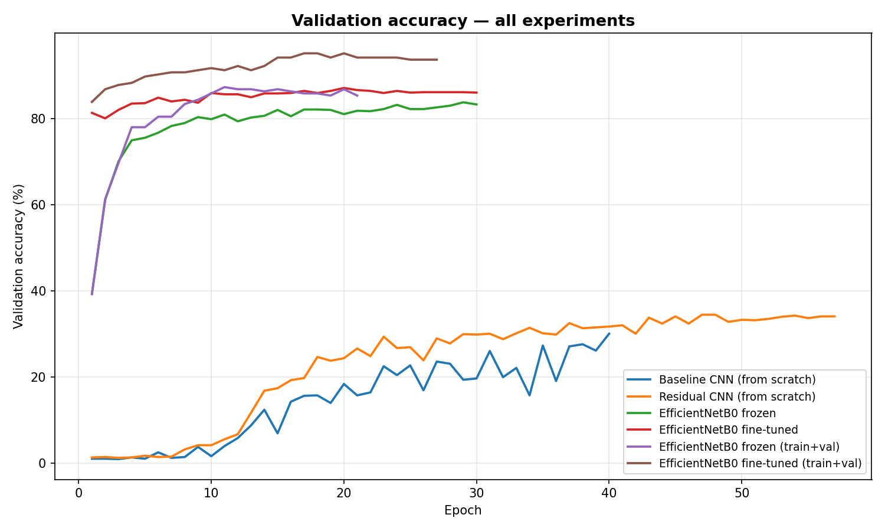

<div align="center">

# Flower Classification

Fine-grained recognition of 102 flower species, from a CNN trained from scratch
to a fine-tuned EfficientNetB0.

[](https://www.python.org/)
[](https://tensorflow.org/)
[](LICENSE)
[](https://github.com/mohammadhashemlou/flower-classification/actions/workflows/ci.yml)
[](tests/)

Best result: **88.66% top-1 / 97.07% top-5** on the official test split.

</div>

---

## About the dataset

[Oxford Flowers 102](https://www.robots.ox.ac.uk/~vgg/data/flowers/102/) has 102
species and 8,189 images, but the official training split is only 1,020 images,
roughly 10 per class. That is the whole difficulty of the problem. A model can
hit 100% training accuracy in a handful of epochs and still get half of new
images wrong, so most of the work here is about generalisation rather than
adding capacity.

The repository builds the solution in six stages so each decision has a number
attached to it:

| Stage | Approach | What it tests |
| :--- | :--- | :--- |
| `01` | VGG-style CNN from scratch | How far a plain CNN gets, and whether capacity is even the limit |
| `02` | Custom residual CNN | Whether better gradient flow helps at this data size |
| `03` | EfficientNetB0, frozen backbone | How much ImageNet features are worth |
| `04` | EfficientNetB0, fine-tuned | How much the backbone still needs to adapt |
| `05` | Same as `03`, trained on train+val | Effect of doubling the data |
| `06` | Same as `04`, trained on train+val | Best model |

## Results

Everything below comes from `scripts/benchmark.py` on the official 6,149-image
test split. That split is never used for training or for picking a checkpoint.

| # | Model | Train imgs | Monitor acc | Test top-1 | Test top-5 | Train-val gap |
| :-: | :--- | :---: | :---: | :---: | :---: | :---: |
| 01 | Baseline CNN (from scratch) | 1,020 | 30.0% | 25.96% | 56.46% | +2.2 pp |
| 02 | Residual CNN (from scratch) | 1,020 | 34.4% | 29.89% | 55.83% | +22.1 pp |
| 03 | EfficientNetB0 frozen | 1,020 | 83.7% | 79.85% | 94.18% | +16.2 pp |
| 04 | EfficientNetB0 fine-tuned | 1,020 | 87.1% | 83.70% | 94.67% | +12.9 pp |
| 05 | EfficientNetB0 frozen (train+val) | 1,836 | 87.3% | 79.56% | 93.40% | -0.9 pp |
| 06 | **EfficientNetB0 fine-tuned (train+val)** | 1,836 | **95.1%** | **88.66%** | **97.07%** | +4.4 pp |

<details>
<summary>Notes on the table</summary>

- **Monitor acc** is the validation accuracy used during training for
  checkpointing and early stopping. For stages 01-04 it is the official
  1,020-image val split. For 05-06 it is a 204-image hold-out taken from the
  merged train+val pool.
- **Train-val gap** is final train accuracy minus best monitor accuracy. A big
  gap means memorisation. A small gap with low accuracy means underfitting.
- Stage 01 underfits: 32% train, 30% monitor, 26% test. It is not overfitting,
  it just cannot separate 102 fine-grained classes from 10 examples each.
- Stage 02 has the largest gap (56% train, 34% monitor) and barely beats stage
  01. The skip connections let it memorise harder without learning anything
  more general. Going deeper did not help at this data size.
- Stage 03 fails the other way: 100% train, 83.7% monitor. The ImageNet
  features are good but a frozen backbone with a large head still memorises.
- Stage 05's monitor accuracy (87.3%) overstates its test accuracy (79.6%).
  The hold-out is only 204 images, so a few points of noise is expected. This
  is why the table reports test numbers instead of trusting the monitor column.
- Stage 06 is the only setup where the gap stays small and accuracy is high at
  the same time.

</details>



Per-run curves live in `models/<experiment>/training_curves.png`. To rebuild the
table and this plot, run `python scripts/compare.py`. Raw numbers are in
[`results/`](results/).

## Project layout

```
flower-classification/
├── src/
│   ├── config.py                # paths and hyperparameters
│   ├── data_loader.py           # tf.data pipelines, caching, augmentation, class weights
│   ├── training.py              # callbacks, LR schedule, loss, fit loop
│   ├── evaluation.py            # test metrics, confusion matrix, per-class report
│   ├── utils.py                 # seeding, dataset metadata, plotting
│   └── models/
│       ├── baseline_cnn.py      # VGG-style CNN from scratch
│       ├── residual_cnn.py      # residual network
│       └── transfer_learning.py # EfficientNetB0/B3, ResNet50, MobileNetV3 heads
├── scripts/
│   ├── train.py                 # train any stage, including fine-tuning
│   ├── evaluate.py              # score one checkpoint on a split
│   ├── benchmark.py             # score every checkpoint on the test split
│   ├── compare.py               # rank experiments, plot validation curves
│   ├── gpu_env.py               # registers CUDA DLLs before TF is imported
│   └── generate_notebooks.py    # rebuilds notebooks/ from source
├── notebooks/                   # 01-06, thin wrappers around src/
├── tests/                       # 16 pytest tests
├── models/                      # checkpoints, history, curves (gitignored)
└── requirements.txt
```

The notebooks are thin on purpose. They import from `src/` instead of copying
the pipeline, so there is one copy of each piece of logic to maintain.

## Setup

```bash
git clone https://github.com/mohammadhashemlou/flower-classification.git
cd flower-classification
python -m venv venv
source venv/bin/activate          # Windows: venv\Scripts\activate
pip install -r requirements.txt
```

### Dataset

Download [Oxford Flowers 102](https://www.robots.ox.ac.uk/~vgg/data/flowers/102/)
(`102flowers.tgz`, `imagelabels.mat`, `setid.mat`) and unpack it like this:

```
dataset/raw/oxford_flowers102/
├── jpg/                 # 8,191 images: image_00001.jpg ...
├── imagelabels.mat
└── setid.mat
```

### GPU on Windows

TensorFlow stopped shipping native Windows GPU support after 2.10, so
`requirements.txt` splits the versions by platform:

| Platform | TensorFlow | CUDA | cuDNN |
| :--- | :--- | :--- | :--- |
| Windows | 2.10.0 | 11.8 (`nvidia-*-cu11` wheels) | 8.9 |
| Linux | 2.16-2.18 | 12.x | 9.x |

`scripts/gpu_env.py` puts the CUDA and cuDNN folders on the DLL search path
before TensorFlow loads, and handles both wheel layouts (`bin/` and `lib/x64/`).
To check what it finds:

```bash
python scripts/gpu_env.py
```

Without it TensorFlow falls back to CPU without complaining, and training is
about 25x slower.

## Training

```bash
# Stage 06, in two phases
python scripts/train.py --model transfer --backbone efficientnetb0 \
    --train-on-trainval --head-units 512 --epochs 40 --lr 5e-4 \
    --experiment 05_efficientnet_frozen_x2

python scripts/train.py --model transfer --backbone efficientnetb0 \
    --train-on-trainval --epochs 30 --lr 1e-4 --cosine --fine-tune \
    --unfreeze-layers 100 \
    --init-from models/05_efficientnet_frozen_x2/best_model.keras \
    --experiment 06_efficientnet_finetuned_x2

# From-scratch baselines
python scripts/train.py --model baseline --epochs 40 --experiment 01_baseline_cnn
python scripts/train.py --model residual --epochs 60 --lr 5e-4 --cosine \
    --experiment 02_residual_cnn
```

## Evaluating

```bash
python scripts/benchmark.py     # every checkpoint -> results/test_metrics.csv
python scripts/compare.py       # ranked table + results/comparison.png
python scripts/evaluate.py --checkpoint models/06_efficientnet_finetuned_x2/best_model.keras \
    --confusion-matrix --report
```

## Design notes

**Transfer learning, in two phases.** With around 10 images per class, a CNN
from scratch tops out near 26% test accuracy (stage 01). ImageNet features
already encode the textures and shapes that separate flower species, so only a
small head has to learn anything. Unfreezing the backbone immediately destroys
those features with large early gradients, so phase 1 trains the head with the
backbone frozen and phase 2 fine-tunes the top 100 layers at a 5x lower
learning rate.

**Caching decoded images in RAM.** JPEG decoding was the bottleneck: the
pipeline ran at 0.8 steps/s and the GPU sat idle. Decoding once to `uint8`,
caching, and casting to `float32` after the cache took an epoch from 319 s to
12 s, about 26x. Shuffling still happens every epoch because it runs after the
cache.

**Training on train+val for the final model.** 1,020 images for 102 classes is
the real constraint. Merging the official val split doubles it to 2,040, and a
204-image slice is held out only to drive early stopping. The test split is
untouched. This one change moved test accuracy from 83.7% to 88.66%.

**A compact head by default.** A 512-256 MLP head has about 660k parameters,
more than enough to memorise 1,020 images, which is exactly what stage 03 does.
The default head is a single dropout-regularised linear classifier with about
130k parameters. The wide head is still available with `--head-units 512` and it
wins once the dataset doubles, which is why the final model uses it.

**Controlling overfitting.** Augmentation lives inside the model (flip, rotation,
zoom, translation, contrast) and is a no-op at inference, so the exported model
needs no separate preprocessing. On top of that: label smoothing at 0.1 through
a registered `keras.losses.Loss` subclass, inverse-frequency class weights,
dropout on the pooled features, BatchNorm left frozen inside the backbone during
fine-tuning, early stopping on `val_accuracy` with best-weight restore, and
cosine LR decay for the fine-tuning phase.

**The `Rescaling(255)` layer before EfficientNet.** Keras' EfficientNet bundles
its own normalisation and expects raw `[0, 255]` pixels, while this pipeline
emits `[0, 1]`. Without the bridge the model still trains, it just loses tens of
accuracy points, which makes it an easy bug to miss.

## Problems hit along the way

Each of these was a real failure while building the pipeline, and each now has a
guard or a test:

| Symptom | Cause | Fix |
| :--- | :--- | :--- |
| GPU idle at 0.8 steps/s | JPEG decoded every epoch | `cache()` the `uint8` images before shuffling |
| `Unknown loss function: sparse_ce_smooth_0.1` on load | Loss was a closure | Registered `Loss` subclass with `get_config()` |
| Training hung after the last epoch | `plt.show()` on a GUI backend in a headless run | Force `Agg`, always write a PNG, never call `show()` |
| `CosineDecay * int` TypeError | `ReduceLROnPlateau` cannot mutate a schedule | Skip it when a schedule is active |
| CSV logged `lr` as an object | Optimizer LR was a callable | Resolve the schedule to a float before logging |
| `You must compile your model` on evaluate | Checkpoint loaded with `compile=False` | Recompile before `.evaluate()` |
| `.keras` save failed on EfficientNet | Internal `Rescaling` held EagerTensors | Coerce `scale`/`offset` to plain floats |
| Notebook cells rendered as one line | Source lines split without `\n` | `splitlines(keepends=True)` in the generator |

## Tests

```bash
python -m pytest tests/ -v
```

16 tests covering the pipeline (batch shapes, value range, split disjointness,
class weights), the model builders (head size, scaling layer, backbone
validation), serialisation (a `.keras` round-trip with no `custom_objects`) and
the LR schedule. Tests that need the dataset skip themselves when it is missing,
so CI runs without it.

## License

Released under the [MIT License](LICENSE).
